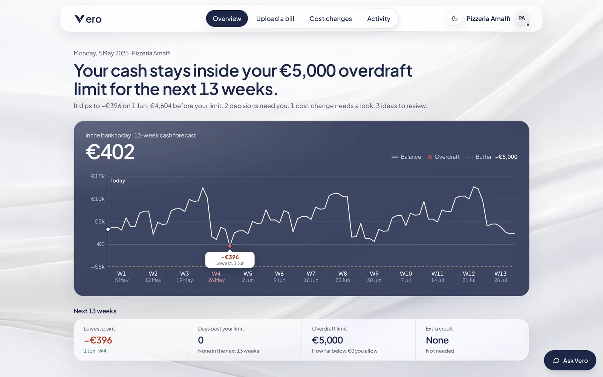
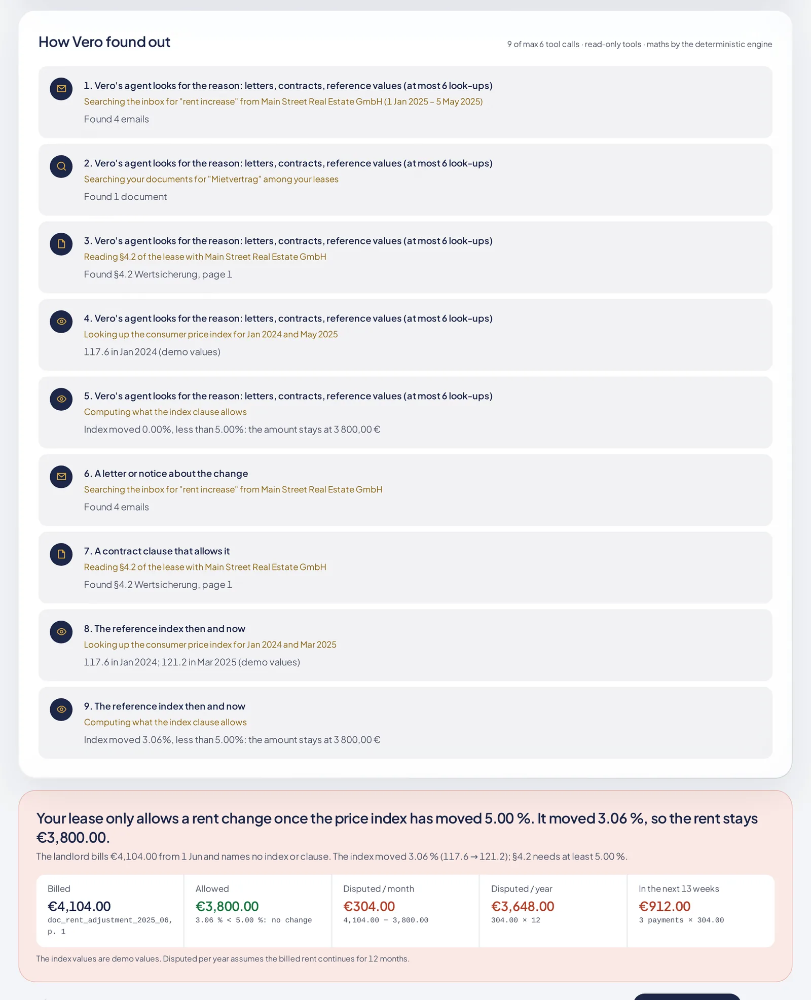
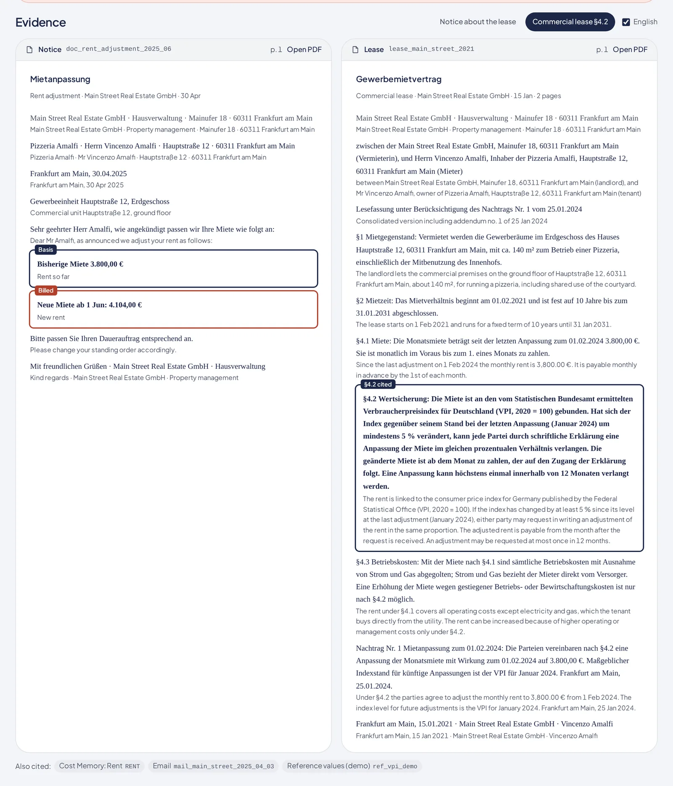
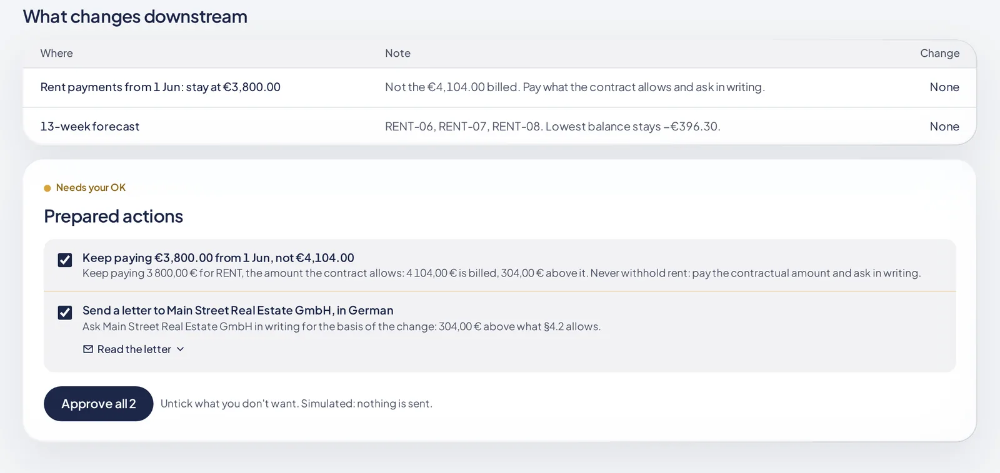
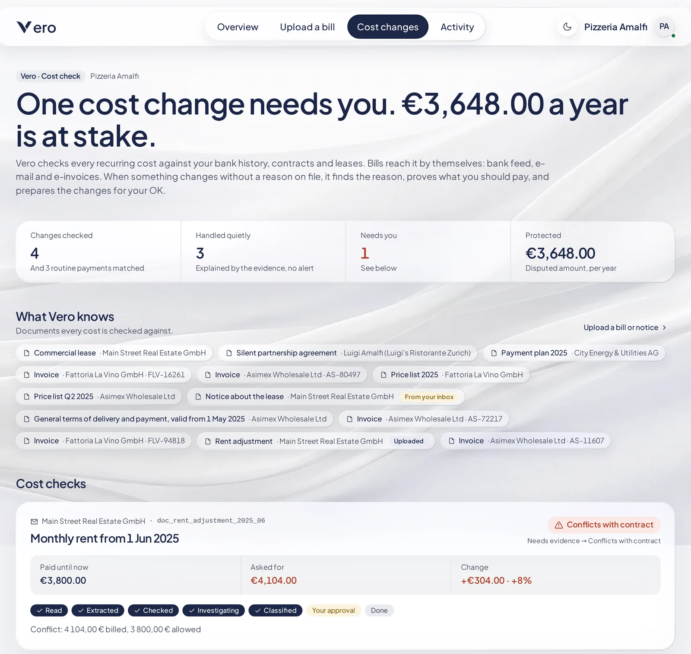
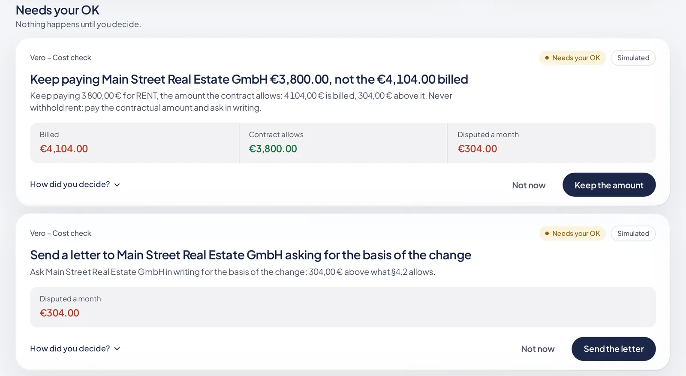
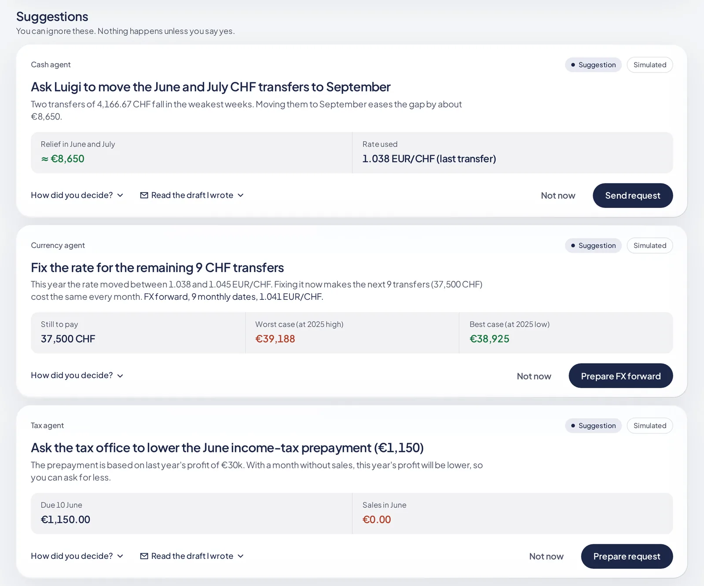
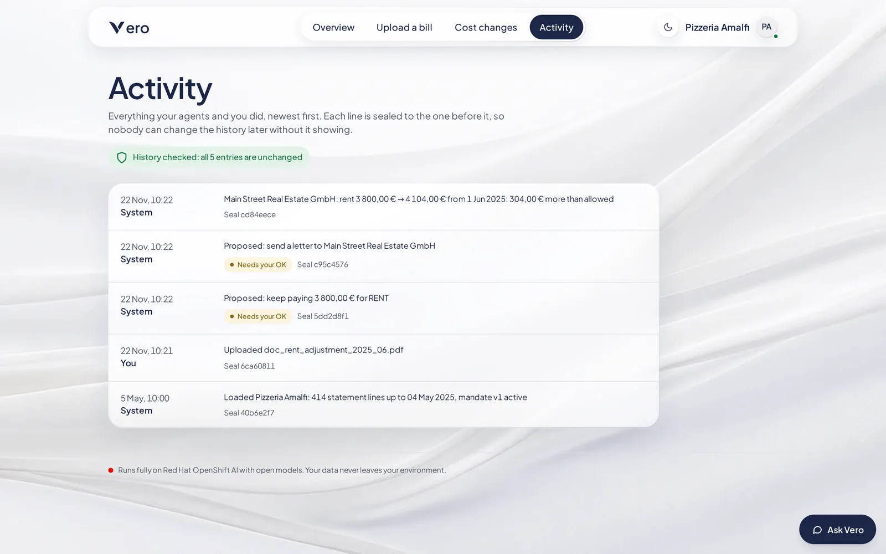
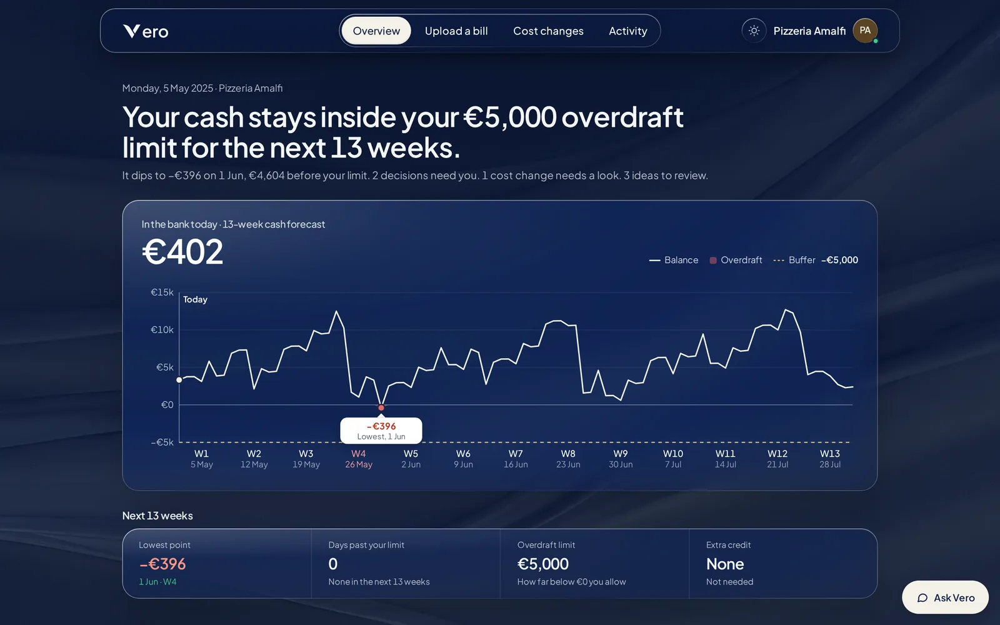
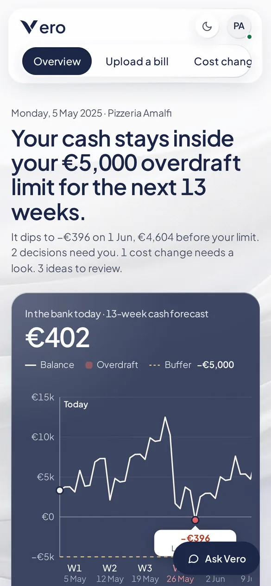

# Vero: an autonomous CFO for small businesses

Vero forecasts a small business's cash for the next 13 weeks, checks every recurring cost against what the business should actually pay, and investigates changes nobody explained. It acts only within rules the owner sets, asks before anything that matters, and shows every step in plain language.

Built at **Collabothon 2026** for the **Commerzbank × Red Hat "Autonomous CFO" challenge** by team **Hold My Laptop**. The demo runs on Red Hat OpenShift AI with an open-weights model (Qwen3-8B FP8 served by vLLM). This repository is my personal copy of the team's repository ([hold-my-laptop/autonomous-cfo](https://github.com/hold-my-laptop/autonomous-cfo)), with the full history of every contributor.



## The idea

Every business, whatever its size, starts small, and the owner of a small business wears every hat, including the CFO's, usually without training for it. According to the European Commission, one in four bankruptcies in the EU are caused by invoices not being paid on time: the money runs out slowly, then all at once.

Vero is one AI finance organisation with two agents, shown on **Pizzeria Amalfi** in Frankfurt:

- **Vero Cash** forecasts 91 days of cash from the real bank statement provided by the organizers. When the owner plans to close for June, the balance would fall below the overdraft floor from 15 June. Vero postpones a partner transfer where the owner's rules allow it, proposes a €20,000 credit line for approval, and refuses to touch payroll because the rules protect it.
- **Vero Proof** checks recurring costs. The landlord raises the rent from €3,800 to €4,104. Nothing on file explains it, so the agent investigates: it searches the inbox, finds the lease, reads clause §4.2 (index adjustment), looks up the consumer price index and has the formula engine compute the change. The index moved 3.06%; the lease allows an adjustment only from 5%. Result: a **conflict of €304 a month, €3,648 a year**. Vero prepares two actions for approval: keep paying €3,800 (never withhold rent) and a letter to the landlord in German asking for the basis of the increase.

**The core design rule: the model proposes, the backend decides.** Only a deterministic formula engine computes numbers. Every value the model reads from a PDF is re-checked against the printed text, and every piece of evidence the agent cites is re-checked against what the tools actually returned. The backend, not the model, sets the final label. When the agent can't support its answer, Vero runs its own fixed steps and reaches the same result. Every action has a receipt, and the activity log is hash-chained.

## Screenshots

These were captured from the live OpenShift deployment on 22 November 2026, after the final presentation.

**The investigation.** At step 5 the agent computed with the wrong index month (0.00%). The backend's evidence check rejected that answer, and Vero's own steps (6–9) reached the correct 3.06%.



**The evidence.** Each claim points at the highlighted passage in the landlord's notice and in the lease.



**Prepared actions.** The owner approves or declines. Execution is simulated.



| | |
|---|---|
|  |  |
| Cost changes: one change needs the owner, three are handled quietly | Decisions waiting for the owner, each with "How did you decide?" |
|  |  |
| Suggestions the owner can ignore | The sealed activity log |
|  |  |
| Dark mode | Phone width |

## Team and contributions

| Who | Role | Main areas |
|---|---|---|
| **Michele** (me) | Backend | `services/api`: the financial engine, rules, investigations and storage (details below) |
| Ege, Ibrahim | AI service | `services/ai`: model client, prompts, the agent loops, PDF extraction, the owner chat |
| Omar, Khaled | Frontend | `apps/web`: the React owner interface |
| Furkan | DevOps | `deploy/openshift`: cluster deployment, GPU model serving, Tekton pipelines, MLflow, CI |

### My part: the backend

I designed and built the FastAPI backend (`services/api`), which owns the data, the domain logic and every number the product shows. I also wrote the Phase 2 design ([docs/PROOF.md](docs/PROOF.md)) and the backend spec ([docs/BACKEND.md](docs/BACKEND.md)), and kept the AI service contract ([docs/contracts](docs/contracts)) in sync with the AI team.

**Vero Cash**
- **Forecast:** imports the bank statement, detects recurring payments, models revenue and builds a 91-day cash forecast, with a backtest error of €663 (3%) ([`domain/forecast.py`](services/api/src/api/domain/forecast.py), [`recurring.py`](services/api/src/api/domain/recurring.py), [`backtest.py`](services/api/src/api/domain/backtest.py)).
- **Planner and credit sizing:** finds the payments that can be moved to keep cash above the floor, and sizes a credit line when moving payments isn't enough ([`planner.py`](services/api/src/api/domain/planner.py), [`credit.py`](services/api/src/api/domain/credit.py)).
- **The owner's rules (the mandate):** versioned rules covering the cash floor, acting alone, per-action and per-day limits, protected categories, credit and a pause switch. A policy engine sorts every proposed action into *done alone*, *needs approval* or *not allowed*, and explains which rule decided ([`policy.py`](services/api/src/api/domain/policy.py)). Execution is simulated, and only three functions may change the payment schedule.

**Vero Proof**
- **Cost Memory and checks:** what each recurring cost should be, built from contracts, price lists and the bank history. Every new bill is compared with it ([`domain/proof/cost_memory.py`](services/api/src/api/domain/proof/cost_memory.py), [`check.py`](services/api/src/api/domain/proof/check.py)).
- **Extraction checks:** every value the model reads from a PDF must match the printed text, and dates, VAT rates, quantity × price and totals must add up ([`extraction.py`](services/api/src/api/domain/proof/extraction.py)).
- **Formula engine:** the only place Phase 2 numbers are computed ([`engine.py`](services/api/src/api/domain/proof/engine.py)).
- **Agent tools:** read-only tools for the investigation agent (inbox and document search, clause reading, index look-up, compute), with a budget of 6 calls per run, behind an internal API secured with a token ([`proof_tools.py`](services/api/src/api/proof_tools.py)).
- **Grounding:** checks the agent's evidence and compute inputs against the tools' real results, by source and by month, then sets the label itself. The billed amount can never serve as the base ([`grounding.py`](services/api/src/api/domain/proof/grounding.py)).
- **Scripted investigation:** Vero's own fixed steps. They take over whenever the agent fails, times out or gives an answer it can't support ([`scripted_investigation.py`](services/api/src/api/scripted_investigation.py)).
- **Downstream effects and actions:**
  - carries the result into the payment schedule and the forecast ([`propagation.py`](services/api/src/api/domain/proof/propagation.py));
  - prepares the actions for approval ([`proof_actions.py`](services/api/src/api/proof_actions.py));
  - writes the letter, checking the agent's draft like any other model output ([`letters.py`](services/api/src/api/letters.py));
  - builds the "handled quietly" digest ([`digest.py`](services/api/src/api/digest.py)).

**Platform**
- **Activity log:** SHA-256 hash-chained; changing any past entry breaks the chain ([`audit.py`](services/api/src/api/audit.py)).
- **Storage:** a repository layer with in-memory and PostgreSQL implementations; SQLModel stays inside [`persistence.py`](services/api/src/api/persistence.py).
- **API behaviour:** idempotency keys on every state-changing request; errors as problem+json; an OpenAPI contract that is checked in the tests.
- **Demo:** a reset that restores the demo state in under 5 seconds.
- **Tests:** 554 API tests, run on in-memory and on PostgreSQL storage. They include two end-to-end release gates that replay both demo stories with the exact presentation numbers ([`test_scenario.py`](services/api/tests/test_scenario.py), [`test_proof_scenario.py`](services/api/tests/test_proof_scenario.py)).
- **Hardening before the demo:**
  - about 1,400 fuzzed requests with zero server errors;
  - race checks on parallel uploads, approvals and resets;
  - end-to-end runs of the AI team's agent loop against the backend.

## Architecture

```
React web app ──► FastAPI backend ◄──► AI service (agent loops, extraction, chat) ──► vLLM on OpenShift AI
                  data · forecast · rules · formula engine · grounding · PostgreSQL     Qwen3-8B FP8
```

The AI service calls only read-only tools on the backend's internal API, which is not exposed outside the cluster. The rules check and execution are never tools. More detail: [Architecture overview](docs/ARCHITECTURE_OVERVIEW.md) · [Architecture](docs/ARCHITECTURE.md) · [Design and demo numbers](docs/DESIGN.md) · [AI service](docs/AI_SERVICE.md) · [OpenShift](docs/OPENSHIFT.md).

| Component | Technology |
| --- | --- |
| Owner interface | TypeScript, React, Vite, TanStack Query, Tailwind CSS |
| Backend | Python 3.12, FastAPI, Pydantic v2, SQLModel, PostgreSQL 16, pytest, ruff |
| AI service | Python, OpenAI-compatible client, pypdfium2, MLflow tracing |
| Model and platform | Qwen3-8B FP8 on vLLM, Red Hat OpenShift 4.20, OpenShift AI, one NVIDIA L4 GPU, Tekton, GitHub Actions |

## Run locally

The organizer's bank statement is **not** included. It was provided for the challenge only and has been removed from this repository's history. Place it at `data/pizzeria-amalfi-bank-statement-2025-v6.csv`. Without it, the data-dependent tests are skipped.

Copy [the environment template](infra/.env.example) to `infra/.env`. Set `LLM_MODE=stub` for the fixture demo, or set `LLM_MODE=live` with an OpenAI-compatible `LLM_BASE_URL`.

```sh
docker compose -f infra/docker-compose.yml --profile app up -d --build --wait
```

Open http://localhost:8080. On **Upload a bill**, choose the landlord's rent adjustment, then open **Cost changes**.

Backend only:

```sh
cd services/api
uv run pytest -q
uv run fastapi dev
```

## Repository guide

| Path | What to look for |
| --- | --- |
| [services/api](services/api) | Forecast, rules, Proof pipeline, grounding, persistence and tests (my part) |
| [services/ai](services/ai) | Model client, prompts, agent loops, PDF processing |
| [apps/web](apps/web) | Owner interface and browser mocks |
| [deploy/openshift](deploy/openshift) | Deployments, GPU model serving, Tekton pipelines |
| [notebooks](notebooks) | Cash-flow analysis, model benchmarks, agent evaluation |
| [docs](docs) | Design, architecture, contracts, Proof design, screenshots |

## Honest limits

- The bank statement is real challenge data. The lease, letters, emails, price lists and index values are synthetic, built to agree with it.
- Payments and letters are simulated, and there is no user login in the demo.
- With the final prompt, the live model reliably finds the right lease clause but often asks for an index month that has no published value. In most runs, Vero's own steps finish the investigation, with the same numbers. The trace always shows which path produced the result.
